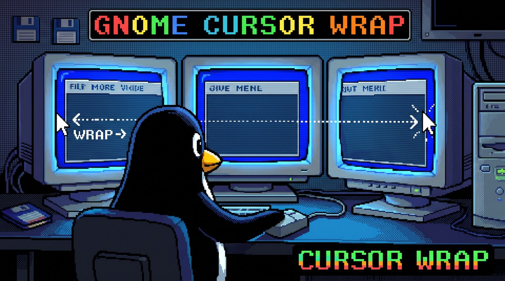

# Cursor Wrap: mouse wrap-around for GNOME on Wayland



**Cursor Wrap** is a GNOME Shell extension that wraps the mouse pointer around
the edges of your screen. Move the cursor off the left edge of your leftmost
monitor and it appears at the right edge of your rightmost monitor, and the
other way round. Top-to-bottom wrapping is optional.

It works on **Wayland**, where X11 tools such as `encircle` or `xdotool`
cannot move the pointer, and supports single-monitor, multi-monitor, and
ultrawide setups on Ubuntu, Fedora, Debian, Arch Linux, and other
distributions with GNOME 48 to 51. If you know PowerToys CursorWrap on
Windows, this is the same idea for the GNOME desktop on Linux.

**[Download the latest release](https://github.com/friscic/gnome-cursor-wrap/releases/latest/download/cursor-wrap@friscic.github.io.shell-extension.zip)**
· [Install instructions](#install) · [FAQ](#faq)

## Why use it

- **Less mouse travel on wide setups.** With two or three monitors or an
  ultrawide screen, getting from the far left to the far right is one short
  flick instead of a long drag.
- **Works on modern GNOME.** Ubuntu and Fedora now run GNOME on Wayland only,
  and the classic X11 pointer-wrapping tools stopped working there. Cursor
  Wrap runs inside GNOME Shell, which is allowed to move the pointer.
- **Stays out of the way.** Edges between monitors work as before, and the
  pointer never wraps while you drag something.

## Features

- Horizontal wrap (far-left ⟷ far-right outer edge), on by default.
- Optional vertical wrap (top ⟷ bottom), on every monitor: the pointer keeps
  its horizontal position and wraps between the highest and lowest monitor at
  that position, even when monitors have different heights.
- Works with one or more monitors and adapts when you rearrange, add, or
  remove displays.
- Only the **outer** edges of the whole layout wrap. Seams between adjacent
  monitors behave normally.
- Monitors with different sizes or vertical offsets are handled: the pointer
  keeps its height when the opposite side has a monitor there, otherwise it
  lands on the closest point of the monitor on that side.
- No wrapping while a mouse button is held, so dragging a window to a screen
  edge to tile it, drag and drop, and text selection keep working.
- No polling on Wayland: the extension only does work when the pointer moves.

## Requirements

- GNOME Shell 48, 49, 50, or 51. Check yours with `gnome-shell --version`.
- A Wayland session. X11 sessions (only GNOME 48 and 49 still have one) are
  supported with a fallback that polls the pointer position every 10 ms.

| GNOME | Distributions (examples) | Tested by the [integration tests](#tests) on |
| --- | --- | --- |
| 51 | Ubuntu 26.10, Fedora 45, Arch Linux | 51.1, Fedora 45 |
| 50 | Ubuntu 26.04 LTS, Fedora 44 | 50.1, Ubuntu 26.04 |
| 49 | Fedora 43 | 49.10, Fedora 43 |
| 48 | Debian 13 (trixie) | 48.7, Debian 13 (Wayland and X11) |

## Install

### From a release zip

Download `cursor-wrap@friscic.github.io.shell-extension.zip` from the
[Releases page](https://github.com/friscic/gnome-cursor-wrap/releases), then:

```bash
gnome-extensions install --force cursor-wrap@friscic.github.io.shell-extension.zip
```

Log out and back in (on Wayland, GNOME Shell only picks up newly installed
extensions at login), then enable it:

```bash
gnome-extensions enable cursor-wrap@friscic.github.io
```

You can also enable it in the Extensions app or Extension Manager.

### From source

Requires `git` and `make`; `gnome-extensions` ships with GNOME Shell.

```bash
git clone https://github.com/friscic/gnome-cursor-wrap.git
cd gnome-cursor-wrap
make install
```

`make install` builds the same zip as a release and installs it with
`gnome-extensions install`. Then log out and back in and enable it as above.

## Settings

Open the preferences window:

```bash
gnome-extensions prefs cursor-wrap@friscic.github.io
```

There are two switches: **Wrap horizontally** (on by default) and **Wrap
vertically** (off by default). Changes apply immediately.

## FAQ

### How do I make the mouse wrap around the screen edges on Ubuntu or Fedora?

Install this extension (see [Install](#install)), log out and back in, and
enable it. The pointer then wraps from the left edge to the right edge.
Turn on **Wrap vertically** in the settings for top and bottom as well.

### Why do encircle, xdotool, or other mouse wrap tools not work on Wayland?

They move the pointer with `XWarpPointer`, an X11 function. On Wayland, apps
are not allowed to move the pointer, so these tools have no effect. Only the
compositor can do it, and in GNOME the compositor is GNOME Shell, where this
extension runs.

### Is this a PowerToys CursorWrap alternative for Linux?

Yes. It provides the same edge wrapping for GNOME: horizontal, vertical, or
both, and no wrapping while dragging.

### Does it work with a single monitor?

Yes. The pointer wraps from one edge of the screen to the opposite edge.

### Does it work with an ultrawide or monitors of different sizes?

Yes. It reads the live monitor layout, including portrait monitors and
monitors at different heights. If the opposite side has no monitor at the
pointer's height, the pointer lands on the nearest point of the monitor on
that side.

### Why doesn't the pointer wrap while I drag a window?

On purpose. Dragging a window to the left or right edge tiles it, and that
needs the pointer to stay at the edge. After a drag ends at an edge, move away
from the edge once and wrapping works again.

### Does it work on KDE Plasma, Xfce, or other desktops?

No. It is a GNOME Shell extension and only runs in GNOME.

## Known limitations

- Anything you reach by pushing the pointer against a wrapping edge gets
  harder to hit, because overshooting now sends the pointer to the other side.
  Examples: a dock on the left or right edge, scrollbars of maximized windows
  on the far right, and the Activities hot corner (top left; Ubuntu turns hot
  corners off by default). Moving the dock to the bottom avoids this with
  horizontal wrapping.
- Left and right edges only wrap on the outer bounding box of the layout. In
  staggered or L-shaped layouts, a left or right monitor edge that faces empty
  space but is not on the bounding box does not wrap. Top and bottom edges
  wrap wherever no monitor is above or below them.
- Pointer barriers from other extensions can stop a wrap partway, for example
  a dock set to auto-hide with "push to reveal" on the side of a monitor in the
  middle of the layout. The pointer then stops at that monitor's edge. GNOME
  Shell's own barriers (hot corners, end of the top bar) are routed around.
- Games that confine the pointer to their window keep it there: the compositor
  applies the confinement to the warp as well.

## Troubleshooting

- **Not listed after installing:** log out and back in.
- **Check that it is running:** `gnome-extensions info cursor-wrap@friscic.github.io`
  should show `State: ACTIVE`.
- **Look for errors:**

  ```bash
  journalctl --user -b -o cat _COMM=gnome-shell | grep -i -A5 cursor-wrap
  ```

When reporting a problem in
[Issues](https://github.com/friscic/gnome-cursor-wrap/issues), include the
output of `gnome-shell --version`, `echo $XDG_SESSION_TYPE`, your monitor
arrangement, and any log lines.

## Uninstall

```bash
gnome-extensions uninstall cursor-wrap@friscic.github.io
```

## How it works

The extension listens to Mutter's cursor tracker, which reports every pointer
motion, and checks once per frame whether the pointer is on the outermost pixel
of the layout's bounding box. If so, it moves the pointer with
`Clutter.Seat.warp_pointer()` to a spot 3 px inside the opposite edge, on a
monitor that covers that edge. Each visit to an edge wraps at most once, so a
blocked warp is not retried in a loop.

Mutter applies pointer barriers to warps, and GNOME Shell puts barriers on
monitor edges near the top of each monitor (hot corners, and the right end of
the top bar on the primary monitor). A straight warp across such an edge stops
at the barrier. So the extension moves the pointer in short straight steps
from monitor to monitor: it crosses each seam between monitors along a row or
column clear of those barriers, which also works when monitors are stacked
above each other.

## Development

`make link` symlinks this directory into the extensions folder instead of
copying it, so changes are picked up at the next login:

```bash
make link
```

With a linked install, remove it with `make uninstall`, and switch to a normal
install with `make install`. Do not run `gnome-extensions uninstall` or
`gnome-extensions install --force` on top of the link: they follow it and
delete the files in this directory, including `.git`.

`make pack` builds `cursor-wrap@friscic.github.io.shell-extension.zip`, which
contains only `extension.js`, `prefs.js`, `metadata.json`, and the schema.
That is the file to upload to extensions.gnome.org or attach to a GitHub
release.

### Lint

```bash
make lint
```

This needs Node.js and npm. It installs the versions pinned in `package.json`
into `node_modules/` and checks the code against GNOME's shared ESLint rules
(`eslint-config-gnome`), the same rules GNOME Shell uses for its own code.
`.vscode/settings.json` sets VS Code-based editors to format code in that
style. `eslint-config-gnome` is pinned to a specific GitLab commit, so
Dependabot cannot bump it; [`RELEASING.md`](RELEASING.md) explains how to
update it by hand.

### Tests

The integration tests in `tests/` install the packed zip into a real GNOME
Shell that runs headless, with virtual monitors and a virtual mouse. Pointer
motion goes through Mutter's real input handling: edge clamping, pointer
barriers, and button state.

```bash
make test                       # on the GNOME Shell installed on this machine
make test-container GNOME=51    # in a container with GNOME 48, 49, 50, or 51
make test-all                   # in containers for all supported versions
```

`make test` is safe to run while you are logged in: every test file gets its
own headless shell with a private session bus, runtime directory, and
settings. The container targets use Docker; set `CONTAINER=podman` to try
Podman (not tested). Logs, results, a screenshot of the preferences window,
and the tested zip are written to `test-logs/`.

| Test file | What it covers |
| --- | --- |
| `wrap.test.js` | Core behaviour on two monitors: both directions, landing spots, no bounce back, button held, settings, layout changes, disable and enable (20 cycles, checking nothing is left behind) |
| `layouts.test.js` | Mixed monitor sizes and offsets, and a push into every outer edge with hot corners on, checking that no barrier stops a wrap |
| `stacked.test.js` | Monitors above each other: laptop below an external monitor (flush and centered), an L shape, and a 2x2 grid, with the primary monitor and its top bar in the middle of the layout |
| `scaling.test.js` | A 1x monitor next to a HiDPI one at 2x and 1.25x, in logical and physical layout mode |
| `prefs.test.js` | The preferences window opens without errors |
| `x11.test.js` | X11 session with the polling fallback; runs only where GNOME Shell has an X11 session (GNOME 48 here) |

A run fails if a check fails, the shell times out, or the extension logs an
error. Header comments in a test file (`// @monitors`, `// @session`,
`// @mutter-features`) set up its shell; the helpers are in
`tests/lib/harness.js`.

`make shellcheck` checks the test scripts with ShellCheck, run from a pinned
container image; CI runs it next to ESLint.

### Continuous integration

[`.github/workflows/ci.yml`](.github/workflows/ci.yml) runs on pushes to
`master`, on pull requests, and on version tags. It runs ESLint and checks
`metadata.json` and the schema, then runs the integration tests on every
supported GNOME version in parallel. The version list has one source of truth,
the `shell-version` array in `metadata.json`, read by
`tests/supported-versions.sh`; the test matrix and the Makefile both read it,
so they cannot drift apart. Each run keeps the logs as artifacts.

Once a month (and on demand) a **canary** job runs the same tests against the
next, not-yet-supported GNOME on a rolling image, as an early warning that a
new GNOME release moved an API the extension relies on. It never gates pushes
or releases. See [`RELEASING.md`](RELEASING.md) for how to adopt a new GNOME
version when the canary passes.

### Releasing

Bump `version-name` in `metadata.json`, update `CHANGELOG.md`, and push a
matching `v<version>` tag; CI runs every check and, if they pass, attaches the
zip tested on the newest supported GNOME to the GitHub release. The full
checklist, including how to adopt a new GNOME version and how to update the
pinned `eslint-config-gnome`, is in [`RELEASING.md`](RELEASING.md).

## License

GPL-3.0-or-later. See [LICENSE](LICENSE).

<p align="center">
  
</p>
